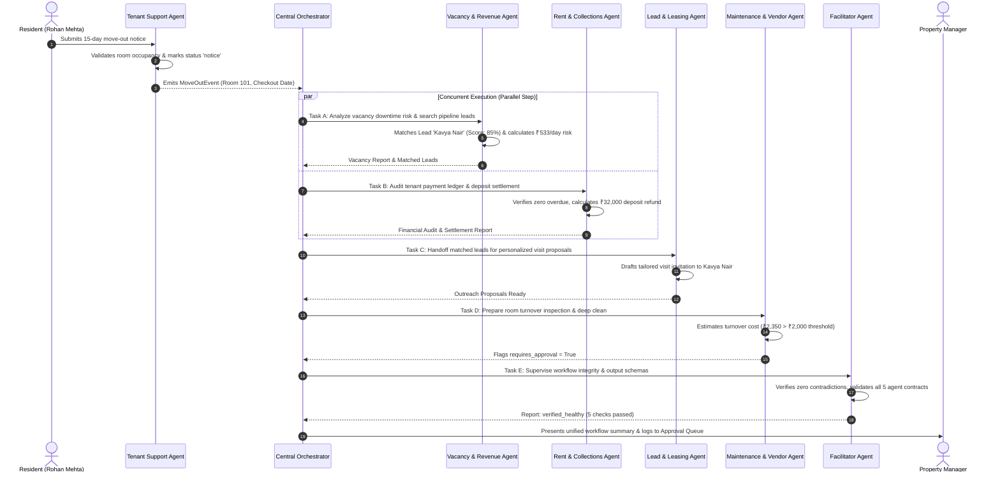

# StayOps AI: Autonomous PG & Co-Living Multi-Agent System

**Team Name:** Synexis  
**Repository:** [https://github.com/sashank-karn/stayOps](https://github.com/sashank-karn/stayOps)

### Team Members & Contributions
| Member | PRN | GitHub | Primary Ownership |
|---|---|---|---|
| **Sashank Karn** | 23070122277 | [`sashank-karn`](https://github.com/sashank-karn) | Central Orchestrator Agent, Facilitator Supervision, Core Models |
| **Sonali Gupta** | 23070122266 | [`Sona1147`](https://github.com/Sona1147) | Lead & Leasing Agent, Inventory Matching, Frontend Operations UI |
| **Prabin Yadav** | 23070122280 | [`Prabin-yadav`](https://github.com/Prabin-yadav) | Tenant Support Agent, Maintenance & Vendor Agent, Approval Gating |
| **Adarsh Jha** | 23070122261 | [`AdarshCodes1221`](https://github.com/AdarshCodes1221) | Rent & Collections Agent, Vacancy & Revenue Recovery Agent |

---

## 1. Project Overview & Approved Architecture

StayOps AI is a multi-agent AI system specifically architected for PG, hostel, and co-living operations. It eliminates operational fragmentation by employing **seven specialized autonomous agents** collaborating over a shared relational data layer:

1. **Lead & Leasing Agent** (`leasing`): Prospective tenant enquiries, requirement extraction, multi-constraint room matching with transparent scoring, lead profiling, visit scheduling, and outreach proposals.
2. **Tenant Support Agent** (`tenant_support`): Resident communication, intent classification, house rules and facility FAQs, and processing 15-day move-out notices.
3. **Maintenance & Vendor Agent** (`maintenance`): Automated ticket triage, contractor dispatch from verified directory, repair cost estimation, room turnover preparation, and human approval gating for high expenses (> ₹2,000 INR).
4. **Rent & Collections Agent** (`collections`): Verified financial ledger tracking, payment status audits, days overdue calculations, security deposit deduction/refund calculation, and tiered reminders.
5. **Vacancy & Revenue Recovery Agent** (`vacancy_revenue`): Portfolio occupancy metrics, downtime financial risk projections, proactive matching of upcoming room vacancies to active leads.
6. **Central Orchestrator Agent** (`orchestrator`): Central workflow coordinator managing branching, concurrent/parallel execution (e.g. Vacancy & Rent agents on move-out notice), sequential handoffs, and audit logging.
7. **Monitoring & Facilitator Agent** (`facilitator`): Supervisory watchdog inspecting agent outputs, validating schemas, detecting contradictions (e.g. negative balances), and bounding retry policies.

---

## 2. Flagship Demonstration: 15-Day Move-Out Workflow



---

## 3. Technology Stack

- **Backend:** FastAPI, Python 3.13, Pydantic v2, SQLAlchemy 2.0 (PostgreSQL / SQLite fallback).
- **Multi-Agent Engine:** Autonomous AgentMessage contract architecture with parallel execution dispatch.
- **LLM & Embeddings:** Google Gemini (`gemini-flash-latest`, `gemini-2.5-flash`), `models/gemini-embedding-001`, ChromaDB vector store.
- **Frontend:** Next.js 14, React 18, TypeScript, Responsive Dark Mode Dashboard.
- **Testing:** Pytest, pytest-asyncio, Starlette TestClient (95 automated unit, agent, workflow, and API tests passing).
- **CI/CD:** GitHub Actions automated CI matrix running backend Pytest suite, Next.js build, and explicit TypeScript type checks.

---

## 4. Setup & Running Instructions

### 1. Backend Environment Setup
```bash
# Activate virtual environment
.venv\Scripts\activate

# Install dependencies from pinned requirements
pip install -r requirements.txt

# Run FastAPI backend
uvicorn backend.app.main:app --reload --host 0.0.0.0 --port 8000
```
Interactive API Documentation is available at: `http://localhost:8000/docs`

### 2. Frontend Dashboard Setup
```bash
cd frontend
npm install

# Run explicit TypeScript validation
npm run type-check

# Launch Next.js dev server (Next.js 14.2.35)
npm run dev
```
Open `http://localhost:3000` to interact with the StayOps Property Manager Dashboard.

### 3. Running Automated Tests
```bash
# Run complete test suite (95 tests across all 7 agents, API endpoints, and workflows)
pytest -v
```

---

## 5. API Reference

| Method | Endpoint | Description |
|---|---|---|
| `GET` | `/api/dashboard/metrics` | Unified occupancy %, monthly collected, overdue balance, open tickets |
| `GET` | `/api/properties` | List managed PG properties, address, capacity, and rules |
| `GET` | `/api/rooms` | List rooms with bed-level status and rental rates |
| `GET` | `/api/tenants` | Resident directory with active leases and move-out status |
| `GET` | `/api/leads` | Prospective tenant leads pipeline |
| `POST` | `/api/leads` | Create new prospective lead enquiry |
| `GET` | `/api/tickets` | Maintenance tickets with trade vendor assignments |
| `GET` | `/api/vendors` | Registered contractor directory with ratings and trade hourly rates |
| `GET` | `/api/approvals` | Human-in-the-loop pending approval requests |
| `POST` | `/api/approvals/{id}/review` | Approve or reject sensitive / high-cost agent tasks |
| `GET` | `/api/workflows` | Audit log of all multi-agent workflow executions |
| `GET` | `/api/workflows/{id}` | Detailed task breakdown and timing for a specific workflow run |
| `POST` | `/api/workflows/move-out` | Trigger the 15-day move-out multi-agent workflow |
| `POST` | `/api/workflows/lead-inquiry` | Trigger lead qualification & room matching via Leasing Agent |
| `POST` | `/rag/query` | RAG semantic search over PG policies, syllabus, and house rules |
| `GET` | `/health` | Service liveness health probe |
